Discente: Felipe Rafael

Exercício 1.1 — Hello World 
        C:\Users\livia\OneDrive\Área de Trabalho\Atv. Docker>docker run hello-world
        Usei o comando "docker run hello-world" para criar o container, apareceu algumas mensagens do próprio docker após
        ele da um pull na imagem, as mensagens ensinando basicamente as instalações do docker.

    1.2
        docker ps -a 
        docker container prune
        em seguida confirmei com "y"

        Mostrou todos os containers inclusive dois hello worlds porque eu executei duas vezes e em seguida eu exclui todos
        com o prune e em seguida dei um ps  -a para confirmar a exclusão de todos

    1.3 
        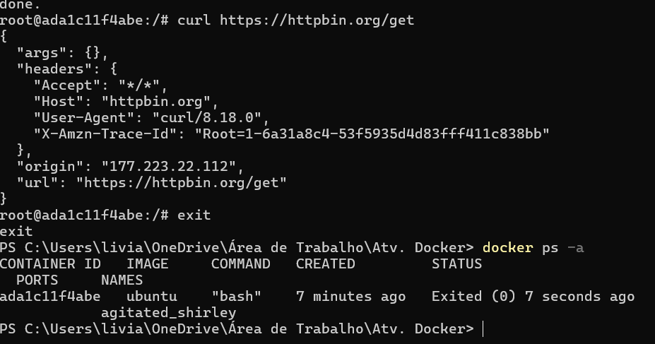
        usei os códigos:
        docker run -it ubuntu bash
        apt-get update
        apt-get install curl
        curl https://httpbin.org/ge
        exit
        docker ps -a

        Executei um container Ubuntu em modo interativo baixei as atualizações como recomendação do curso, após eu baixei
        o curl e fiz uma requisição http e saiu algo acredito que seja no formato json
    1.4
        docker images -a
        docker pull nginx:alpine
        docker rmi hello-world

        Nesse exercício eu listei todas as imagens armazenadas localmente e em seguida removi o hello-world

    1.5
        docker run -d -p 8080:80 --name meu-nginx nginx:alpine
        docker stop meu-ngninx
        docker rm meu-nginx

        Nesse exercício eu usei apenas três comandos, um para criar um container na porta 80, usando o nginx da imagem do
        exercício anterior, abri o site tinha uma mensagem padrão do nginx e após isso encerrei e deletei o container

Nível 2: Dockerfile e Build 

    2.1
        Primeiro  fiz o código em python simples print("Docker Funcionando")
        Após isso fui no Dockerfile
        [text](exercicio2/Dockerfile)
        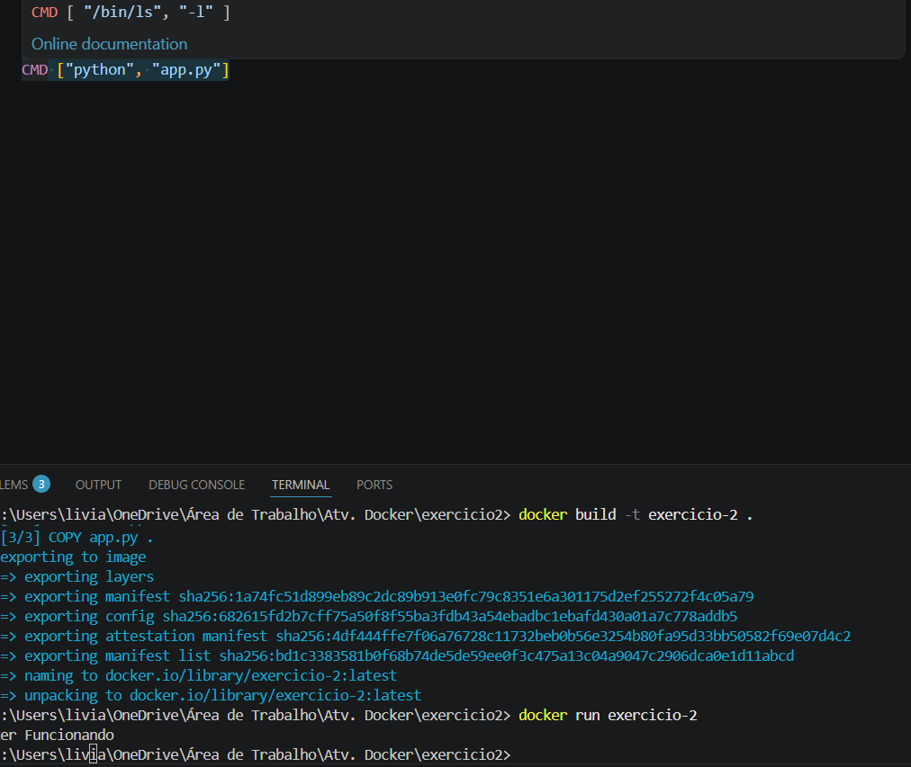

        docker build -t exercicio-2 .
        docker run exercicio-2

        Rodei a imagem que eu criei com a aplicação em python printando no fim a mensagem do Python

    2.2
        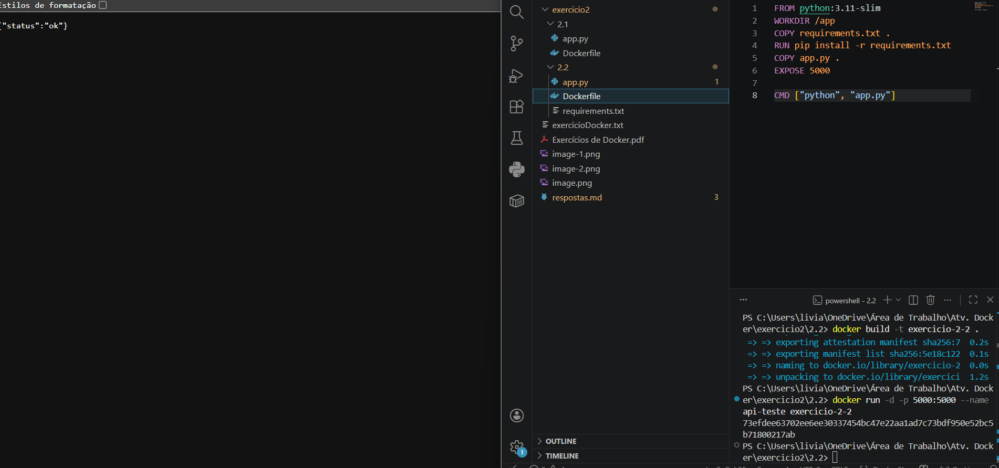
        Comecei com o python e o requirements:
            Flask==3.0.0

        Python:
            from flask import Flask, jsonify

            app = Flask(__name__)

            @app.route('/health')
            def health():
                return jsonify({"status": "ok"})
            if __name__ == '__main__':
                app.run(host='0.0.0.0', port=5000)

        Dockerfile: 
            FROM python:3.11-slim
            WORKDIR /app
            COPY requirements.txt .
            RUN pip install -r requirements.txt
            COPY app.py .
            EXPOSE 5000

            CMD ["python", "app.py"]

        Comandos:
            docker build -t exercicio-2-2 .  
            docker run -d -p 5000:5000 --name api-teste exercicio-2-2

        Explicação:
            Comecei Codificando tanto o requirements quanto o python, após isso configurei o Dockerfile
            Criei a imagem e em seguida rodei usando a porta 5000, testei via web para validação do teste

    2.3
        Criei um .dockerignore com um padrão básico que encontrei na internet, rodei o comando:
            docker build -t exercicio-2-2 .  
        em seguida notei que o build inicializou mais rápido

    2.4
        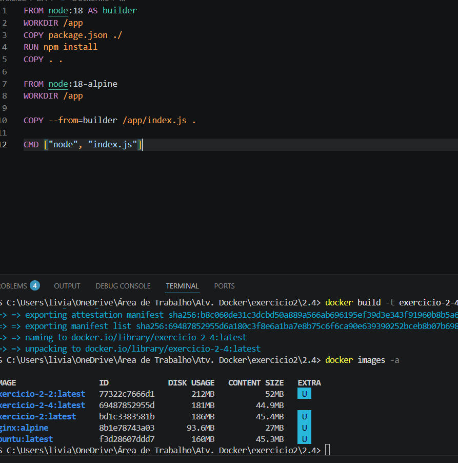
        
        Dockerfile: 
            FROM node:18 AS builder
            WORKDIR /app
            COPY package.json ./
            RUN npm install
            COPY . .

            FROM node:18-alpine
            WORKDIR /app

            COPY --from=builder /app/index.js .

            CMD ["node", "index.js"]

        Comandos:
            docker build -t exercicio-2-4 .
            docker build -t exercicio-2-4 .
            docker images -a

        Explicação:
            Fiz package.json tradicional sem dependências, sem seguida fiz um index.js com console.log para não deixar 
            configurei o dockerfile  para o multistage (sendo estágio1: pegando o tudo em seguida apaguei e fiz o segundo, e o segundo estágio pegando só o que precisa)
            e usei o docker images -a para comparar o tamanho das imagens

    2.5
        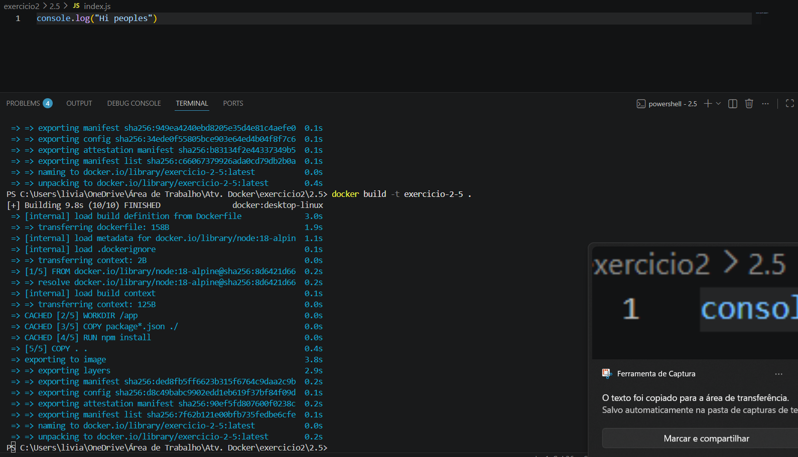
        Comecei com o python e o requirements:
            Flask==3.0.0

        Dockerfile: 
            FROM node:18-alpine
            WORKDIR /app

            COPY package*.json ./

            RUN npm install

            COPY . .

            CMD ["node", "index.js"]

        Comandos:
            docker build -t exercicio-2-5 .
            docker build -t exercicio-2-5 .
         

        Explicação:
            reutilizei o package json e o index da questão anterior para ter uma base, alterei o dockerfile para ele  usar o cache, modifiquei
            o index alterando o console.log e refiz o build para fim de testes e verificar a velocidade do build.
            No caso o tempo do build só vai ser fazendo as alterações

Nível 3: Volumes e Persistência
    3.1
        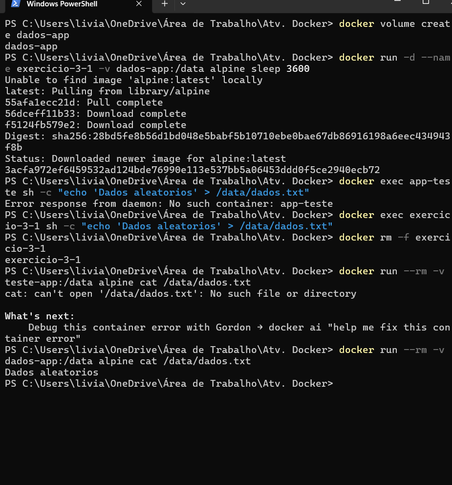
        Comandos:
              docker run -d --name exercicio-3-1 -v dados-app:/data alpine sleep 3600
              docker exec exercicio-3-1 sh -c "echo 'Dados aleatorios' > /data/dados.txt"
              docker rm -f exercicio-3-1
              docker run --rm -v dados-app:/data alpine cat /data/dados.txt

        Explicação:
            comecei criando o container com número do exercicio e montei já o volume no mesmo comando
            em seguida criei o arquivo dentro do volume como indicado no exercicio, removi o container
            e verifiquei se o arquivo dados ainda existia, errei uma parte do comando para olhar se ainda existia corrigi o erro e o volume ainda estava salvo

    3.2
        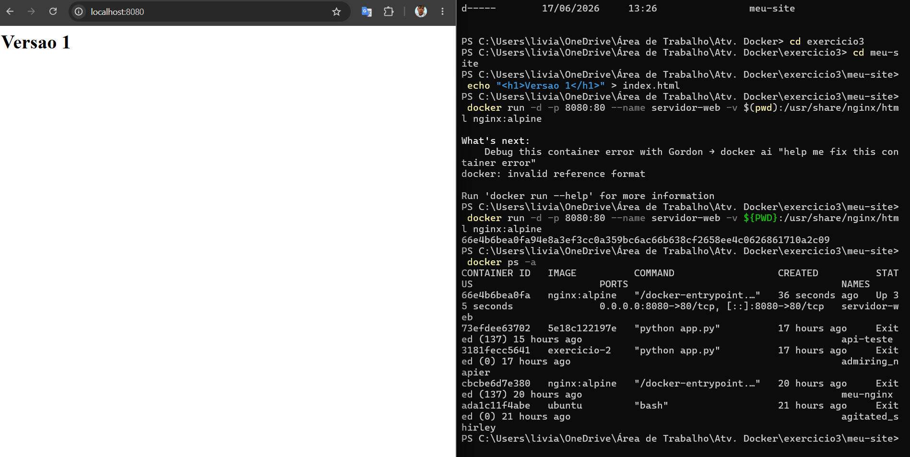
        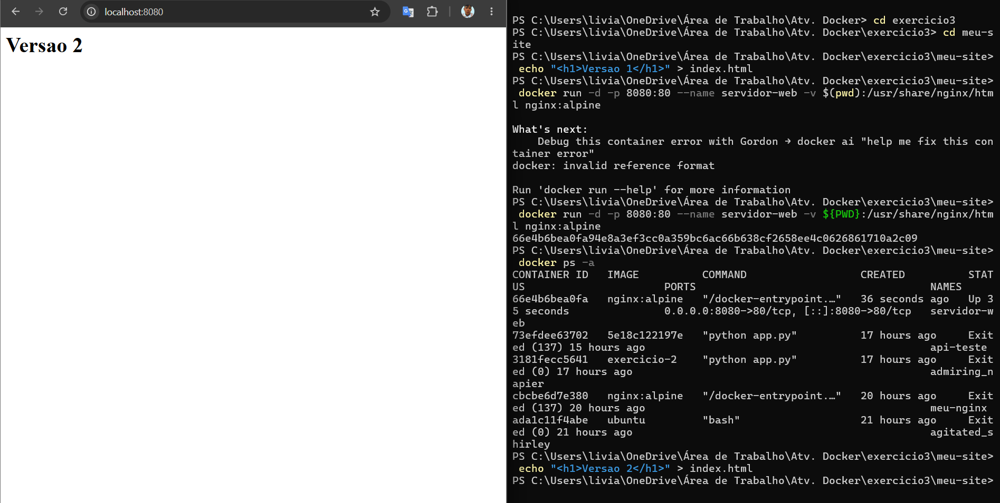

        Comandos:
            echo "<h1>Versao 1</h1>" > index.html 

            docker run -d -p 8080:80 --name servidor-web -v ${PWD}:/usr/share/nginx/html nginx:alpine

            echo "<h1>Versao 2</h1>" > index.html 

    3.3
        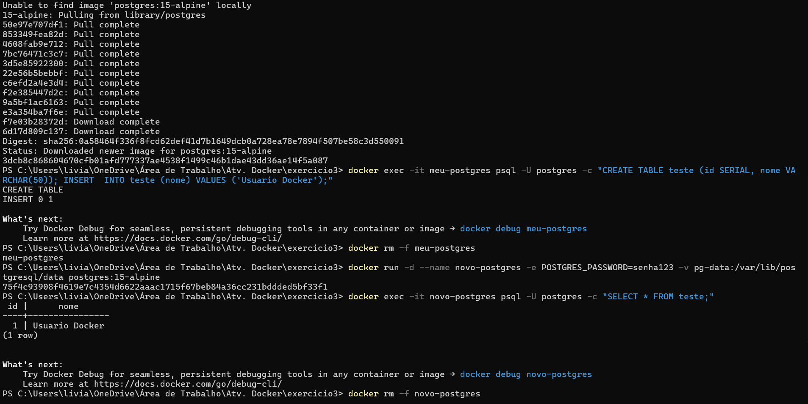

        Comandos:
            docker volume create pg-data
            docker run -d --name meu-postgres -e POSTGRES_PASSWORD=senha123 -v pg-data:/var/lib/postgresql/data postgres:15-alpine
            docker exec -it meu-postgres psql -U postgres -c "CREATE TABLE teste (id SERIAL, nome VARCHAR(50)); INSERT INTO teste (nome) VALUES ('Usuario Docker');"
            docker rm -f meu-postgres
            docker run -d --name novo-postgres -e POSTGRES_PASSWORD=senha123 -v pg-data:/var/lib/postgresql/data postgres:15-alpine
            docker exec -it novo-postgres psql -U postgres -c "SELECT * FROM teste;"

        Explicação:
            Comecei criando um volume para persistir os dados do postgres, criei a variável de ambiente, configurei um table do postgres para receber um nome, inserir um dado nessa tabela, em seguida apaguei o container do postgres e criei outro, para testar se a persistência de dados estava funcionando

4- Networking
    4.1
        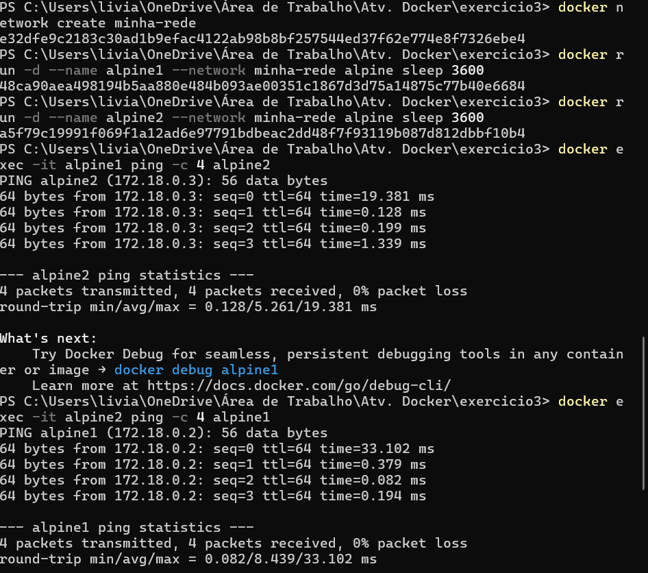
        Comandos:
            docker network create minha-rede
            docker run -d --name alpine1 --network minha-rede alpine sleep 3600
            docker run -d --name alpine2 --network minha-rede alpine sleep 3600
            docker exec -it alpine1 ping -c 4 alpine2

        Explicação:
            Comecei criando uma rede, em seguida criei dois containers rodando em paralelo e com duração suficiente para fazer os testes
            Em seguida fiz o teste se a conexão tava funcionando
    
    4.2 
        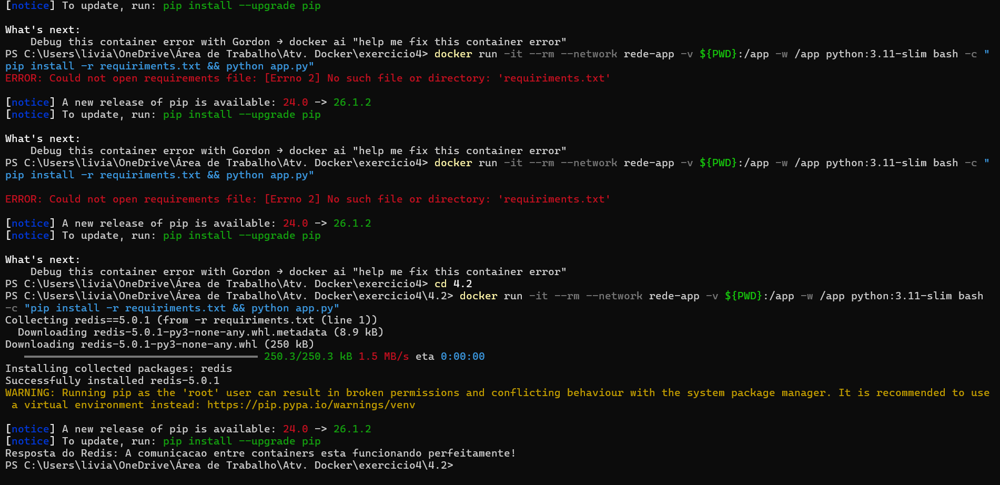
        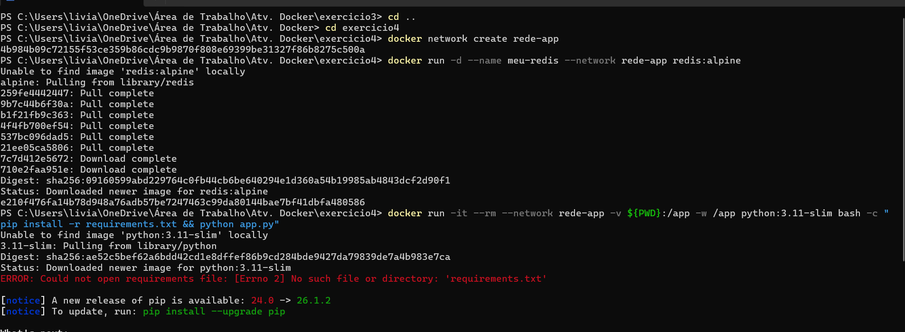

        Códigos:
            Python:
                import redis

                r = redis.Redis(host='meu-redis', port=6379, decode_responses=True)

                r.set('mensagem', 'A comunicacao entre containers esta funcionando perfeitamente!')
                valor = r.get('mensagem')

                print(f"Resposta do Redis: {valor}")
            requirements:
                redis==5.0.1

        Comandos:
            docker network create rede-app
            docker run -d --name meu-redis --network rede-app redis:alpine
            docker run -it --rm --network rede-app -v $(pwd):/app -w /app python:3.11-slim bash -c "pip install -r requirements.txt && python app.py"

        Explicação:
            Comecei criando uma rede, em seguida comecei um container alocando ele a rede que eu criei antes e que a imagem dele seria um rede alpine, em seguida rodei o script python junto com o redis retornando a mensagem que coloquei no script de python. Ocorreram alguns erros devido ao uso de um diretório incorreto. Após corrigir o caminho, a aplicação funcionou normalmente.

    4.3
        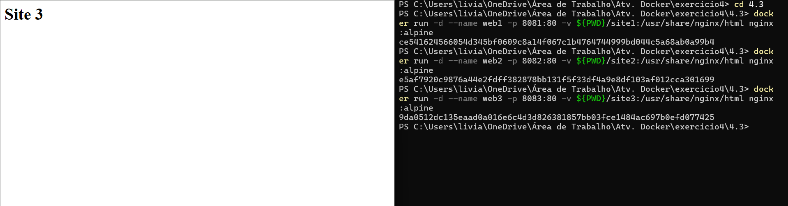
        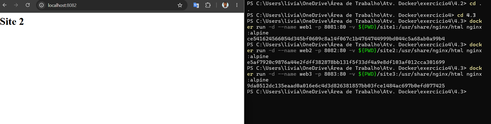
        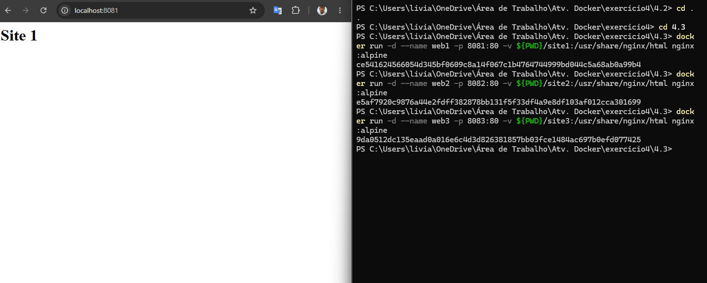

        files:
            três pastas e três sites diferentes mostrando onde cada site está
        Comandos:
            docker run -d --name web1 -p 8081:80 -v ${PWD}/site1:/usr/share/nginx/html nginx:alpine
            docker run -d --name web2 -p 8082:80 -v ${PWD}/site2:/usr/share/nginx/html nginx:alpine
            docker run -d --name web3 -p 8083:80 -v ${PWD}/site3:/usr/share/nginx/html nginx:alpine

        Explicação:
            Criei três pastas com três arquivos index para servirem de base para aplicação nginx, rodei os três servidores usando o PWD para não ter que criar um Dockerfile extenso, e em seguida apenas testei os hosts sendo respectivamente o site:8081 site2:8082 site3:8083
Exercício5 - Docker Compose
    5.1
        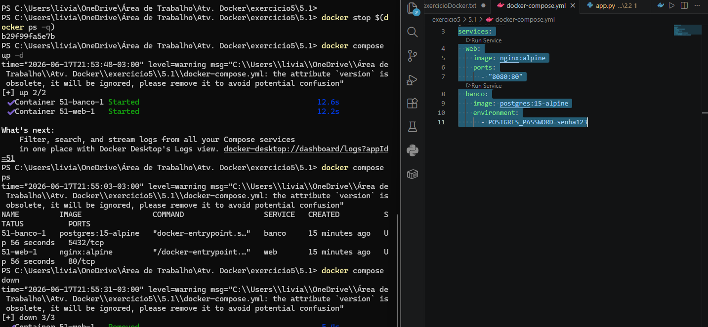

        Código:
            services:
            web:
                image: nginx:alpine
                ports:
                - "8080:80"
            banco:
                image: postgres:15-alpine
                environment:
                - POSTGRES_PASSWORD=senha123

        Comandos:
            docker compose up -d
            docker compose ps
            docker compose down

        Explicação:
            Comecei criando o arquivo compose, em seguida rodei e listei para conferir se ambos containers estavam rodando em seguida removi o compose.

    5.2
        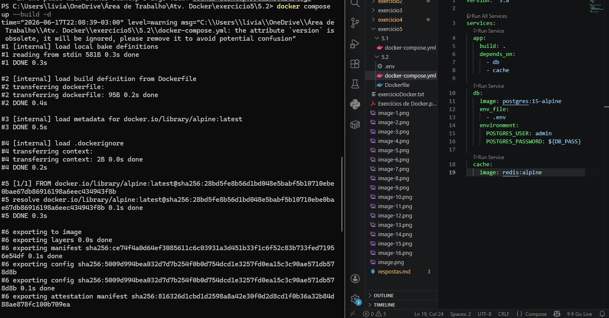
        Códigos:
            compose:
                services:
                app:
                    build: .
                    depends_on:
                    - db
                    - cache

                db:
                    image: postgres:15-alpine
                    env_file:
                    - .env
                    environment:
                    POSTGRES_USER: admin
                    POSTGRES_PASSWORD: ${DB_PASS}

                cache:
                    image: redis:alpine
            Dockerfile:
                FROM alpine
                CMD ["echo", "Minha aplicacao esta rodando!"]
        Explicação:
            Comecei criando o Dockerfile e o .env, depois fui configurar o compose para ele ao invés de baixar uma imagem externa lê-se o arquivo Dockerfile e construir a imagem

    5.3
        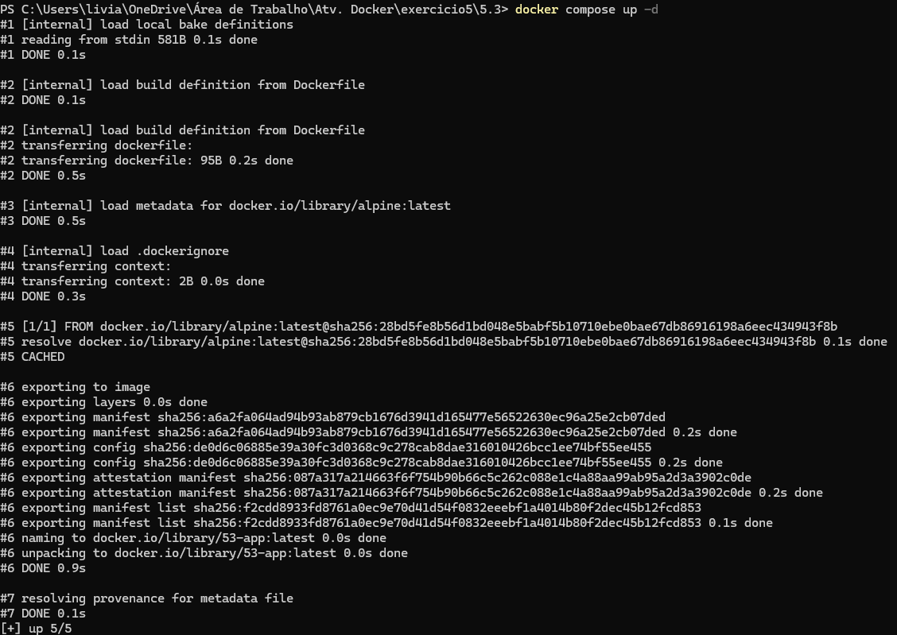
        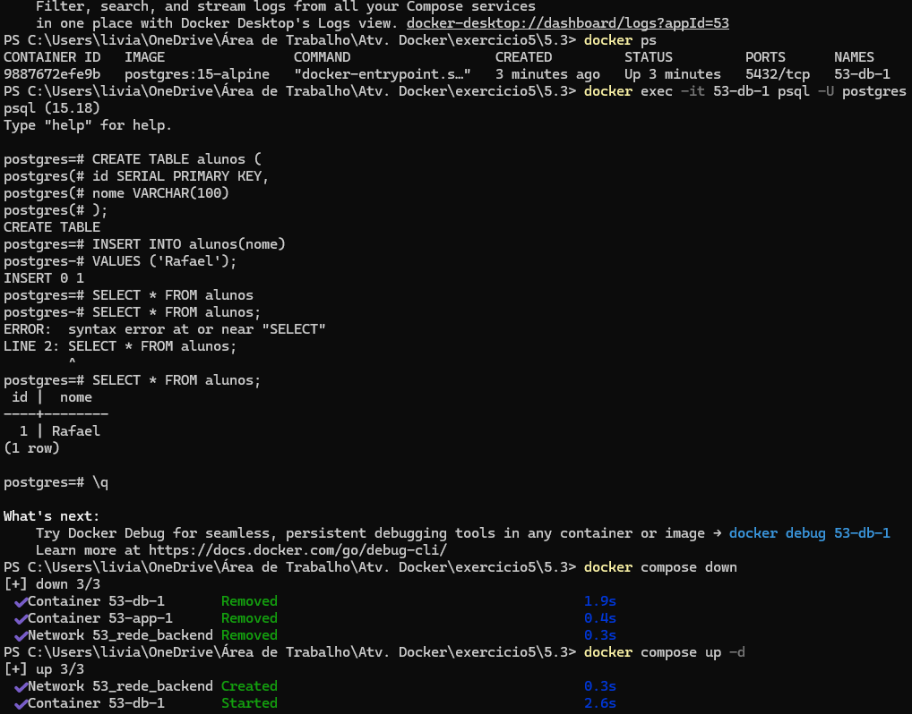
        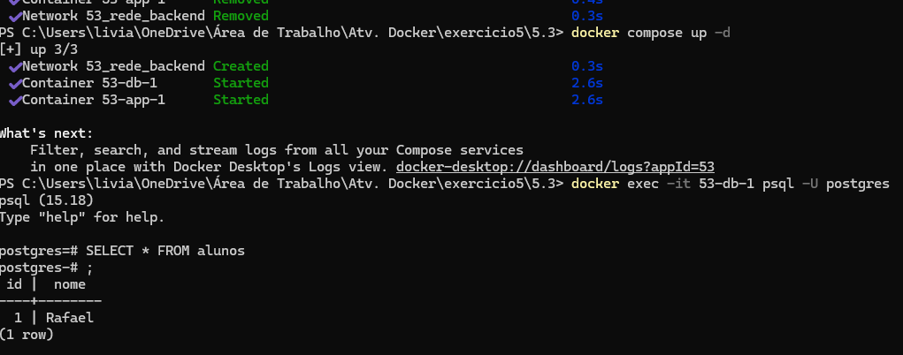

        Códigos:
            reutilizei o Dockerfile e o .env do anterior
            docker-compose: 
                services:
                    app:
                        build: .
                        networks:
                        - rede_backend
                    
                    db:
                        image: postgres:15-alpine
                        environment:
                        POSTGRES_PASSWORD: admin
                        volumes:
                        - pg_dados:/var/lib/postgresql/data
                        networks:
                        - rede_backend

                    volumes:
                    pg_dados:

                    networks:
                    rede_backend: 
        Comandos:

            docker compose up -d
            docker exec -it 53-db-1 psql -U postgres (fiz um insert)
            docker compose up -d
            ocker exec -it 53-db-1 psql -U postgres(fiz um select para ver se tinha funcionado)

    5.4
        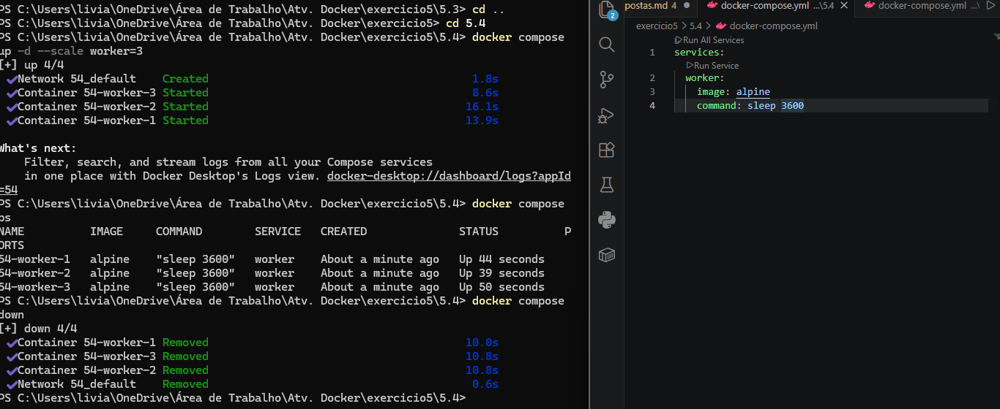

        Códigos:
            services:
                worker:
                    image: alpine
                    command: sleep 3600
        Comandos:
            docker compose up -d --scale worker=3
            docker compose ps

        Explicação:
            Criei um arquivo compose com worker básico,
            em seguida rodei o compose com um escalonamento =3 para subir três réplicas do worker, e listei para ver se os containers tinham sido criados
    5.5
        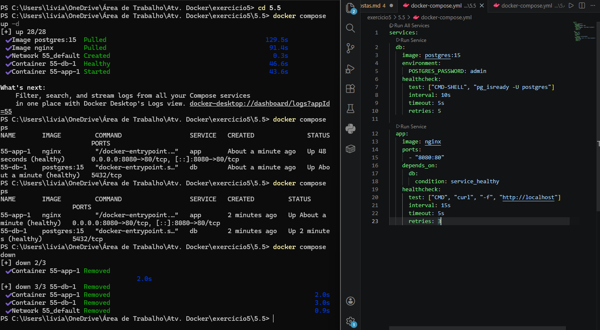

        Códigos:
            docker-compose.yml:
                services:
                    db:
                        image: postgres:15
                        environment:
                        POSTGRES_PASSWORD: admin
                        healthcheck:
                        test: ["CMD-SHELL", "pg_isready -U postgres"]
                        interval: 10s
                        timeout: 5s
                        retries: 5

                    app:
                        image: nginx
                        ports:
                        - "8080:80"
                        depends_on:
                        db:
                            condition: service_healthy
                        healthcheck:
                        test: ["CMD", "curl", "-f", "http://localhost"]
                        interval: 15s
                        timeout: 5s
                        retries: 3
        Explicação
            Eu criei um arquivo compose, que faz um teste com ban co de dados para ver se conseguiu a conexão com o banco de dados ac ada 10s com a espera de 5s(se poasssar retorna timeot tenta 5 vezes)
            Faz o mesmo com o HTTP, mas utilizando o curl -f para caso retornar 400 ele tenta novamente 3 vezes com intervalo de 15 segundos
            Subi o container com o compose e visualizei utilizando o compose ps para verificar se todos estavam ok

        Comandos: 
            docker compose up -d
            docker compose ps
ível 6: Intermediário — Práticas reais
    6.1
            
        Comandos:
            docker run -d --name site-test -p 8080:80 nginx:alpine
            docker logs -f site-test
            docker exec -it site-test sh
                exit
            docker inspect site-test | grep IPAddress
            docker rm -f site-test
        Explicação:
            rodei um container site-test nginx, acessei via local host usei op logs e fiquei dando f5
            para olhar os logs em tempo real, após isso usei exec -it de forma interativa.
            Foi realizada apenas uma inspeção básica do ambiente interno do container.
            depois usei o inspect junto com grep para pegar o endereço Ip
    6.2
        Comandos:
            docker run -it --name teste-limite -m 256m --cpus="0.5" ubuntu bash
            stress --vm 1 --vm-bytes 512M

        Explicação:
            Criei um conteiner em ubuntu com limitador de ram e cpu e baixei o aplicativo de stress, o stress ultrapssou o limite
            e o kernel foi obrigado a encerrar o processo

    6.3
    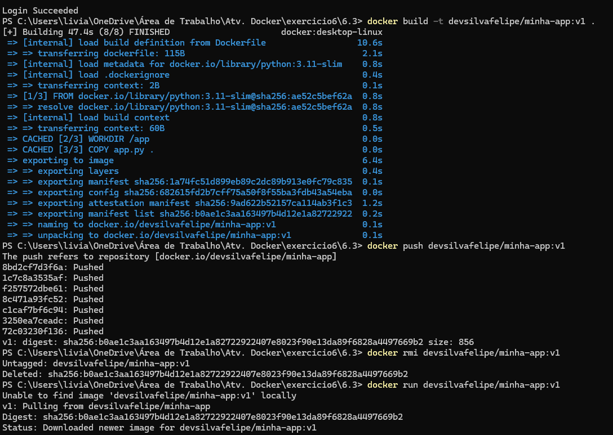
        Comandos:
            docker login
            docker build -t devsilvafelipe/minha-app:v1 .
            docker push devsilvafelipe/minha-app:v1
            docker rmi devsilvafelipe/minha-app:v1
            docker run devsilvafelipe/minha-app:v1
        Explicação:
            Eu játinha feito o login no docker hub,
            então peguei um Dockerfile que eu já tinha criado antes,
            fiz o build da imagem,
            em seguida dei o push subi pro dockerhub
            retirei da minha máquina e puxei de lá a imagem
    6.4
        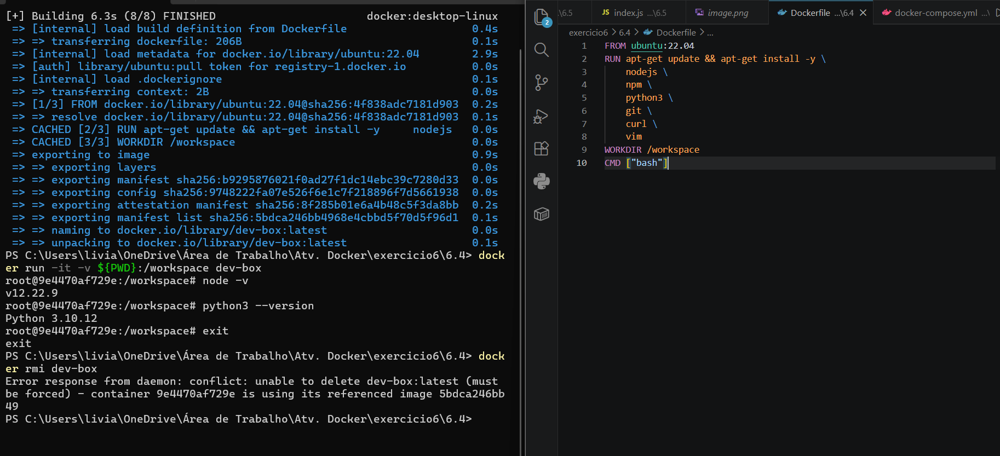
        Códigos:
            Dockerfile:
                FROM ubuntu:22.04
                RUN apt-get update && apt-get install -y \
                    nodejs \
                    npm \
                    python3 \
                    git \
                    curl \
                    vim
                WORKDIR /workspace
                CMD ["bash"]
            Comandos:
                docker build -t dev-box .
                docker run -it -v ${PWD}:/workspace dev-box
                node -v
                python3 --version
                exit
        Explicação: 
            Comecei criando um Dockerfile baseado no Ubuntu e instalei as ferramentas solicitadas no exercício, sendo elas Node.js, Python, Git, curl e vim.
             Após fazer o build da imagem, executei o container utilizando um bind mount para compartilhar os arquivos do projeto entre o host e o container.
              Dentro do ambiente consegui verificar as versões do Node.js e do Python sem precisar instalar nada diretamente na máquina hospedeira, demonstrando que o container estava funcionando como um ambiente de desenvolvimento completo.

    6.5 
        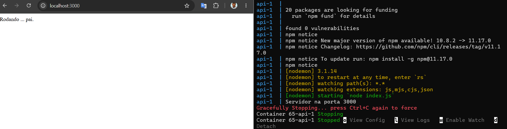
        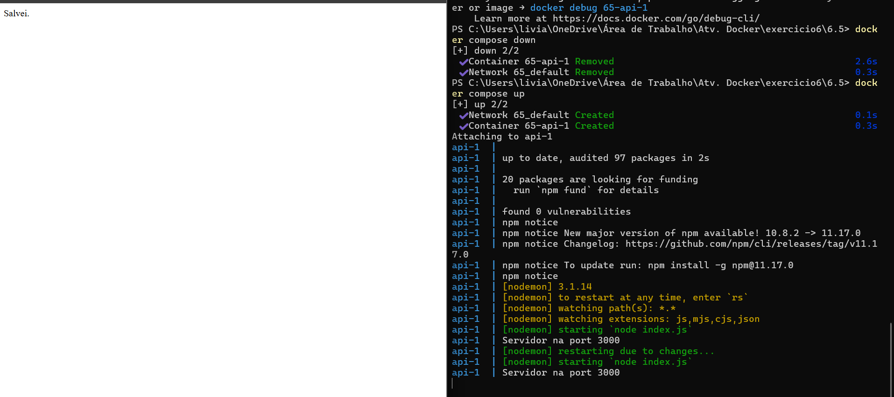
        Scripts:
            docker compose:
                
                services:
                api:
                    image: node:18-alpine
                    working_dir: /app
                    volumes:
                    - .:/app
                    ports:
                    - "3000:3000"
                    command: sh -c "npm install && npx nodemon -L index.js"
                    environment:
                    - NODE_ENV=development
                
            package.json:
                {
                "name": "app-dev",
                "dependencies": { "express": "^4.18.2" },
                "devDependencies": { "nodemon": "^3.0.1" }
                }
            index.js:
                const express = require('express');
                const app = express();
                app.get('/', (req, res) => res.send('Hot reload rodando! Mude este texto e salve.'));
                app.listen(3000, () => console.log('Servidor na porta 3000'));
        Comandos:
            docker compose up
        Explicação:
            Comecei criando um arquivo docker-compose para o ambiente de desenvolvimento e configurei um bind mount para que as alterações feitas no código local fossem refletidas dentro do container.
            Utilizei o Nodemon para monitorar mudanças no arquivo index.js e reiniciar automaticamente a aplicação quando necessário.
            Após subir o serviço com o Docker Compose, alterei o código e observei que a aplicação era
            atualizada sem precisar recriar ou reiniciar manualmente o container, caracterizando o funcionamento do hot reload.

    6.6
        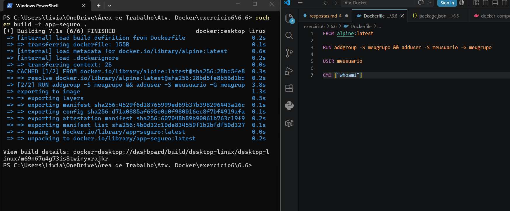
        Códigos:
            Dockerfile:
                FROM alpine:latest

                RUN addgroup -S meugrupo && adduser -S meusuario -G meugrupo

                USER meusuario

                CMD ["whoami"]
        Comandos:
            docker buil -t app-seguro .
            docker run --rm app-seguro
        Explicação:
            Comecei criando um Dockerfile baseado no alpine.
            Em seguida criei um grupo e um usuário sem privilégios.
            Após isso utilizei a instrução USER para que a execução do container deixasse 
            de utilizar o usuário root e passasse a utilizar o usuário criado anteriormente.
            Por fim realizei o build da imagem e executei o container. 
            O comando whoami retornou meusuario, 
            comprovando que a aplicação estava sendo executada com um usuário sem privilégios elevados. 

    6.7
        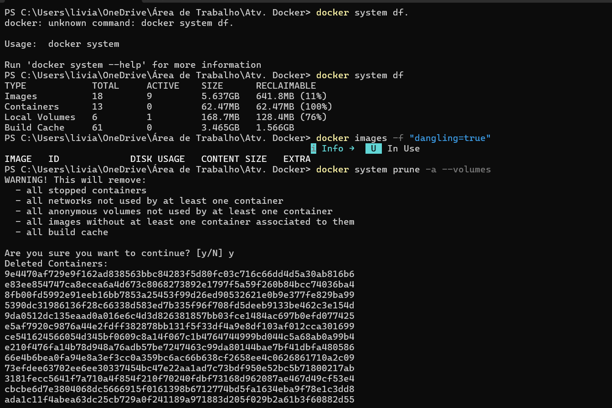
        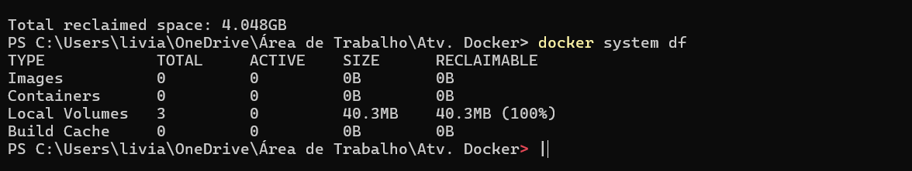
        Comandos:
            docker system df
            docker images -f "dangling=true"
            docker syst
            em prune -a --volumes
            docker system df

        Explicação:
            Usei o system df para ver o quanto o docker estava
            consumindo do meu pc, depois listei as imagens
            e exclui tudo fiz uma faxina com o system prune que retirou todas as imagens e volumes
            e por fim verifiquei a diferença após a limpeza
            e apagou as imagens que não estavam sendo usadas além das danglings e
            os volumes que não estavam anexados
